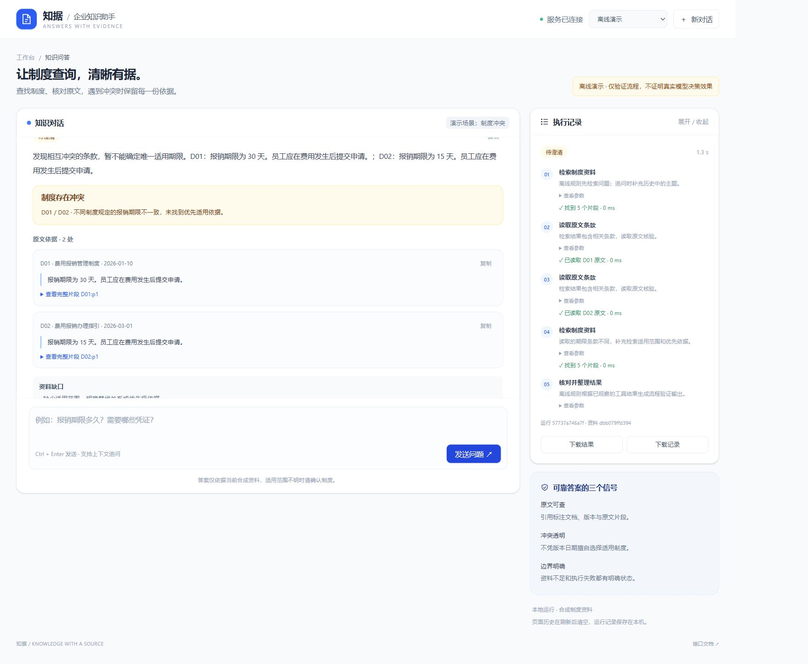

# 知据 · 企业知识问答 Agent

题号：**3**。AI 辅助范围：代码生成与测试；个人修改：修正技术方案。提交信息见 [submission.json](submission.json)。

项目累计墙钟用时约 **1 小时 35 分钟**（统计截至 2026-10-28 13:34:02，UTC+8），其中首个可提交版本用时 **1 小时 22 分钟**；包含交互和必要等待，详见 [用时依据](examples/verification/project-time.json)。

用原文回答制度问题，让冲突、缺口和执行过程可见。提供 Tailwind CSS Web 页面、实时 HTTP 接口与 CLI，三者复用同一套 LangGraph Agent。

> 当前交付状态：已用 `https://api.deepseek.com` 的 `deepseek-flash` 完成真实测试，完整回归 20/20 自动检查通过；扩充后的 Mock 也是 20/20。首轮真实失败、定向复测与最终回归全部保留。Mock 是脚本化替身，不能代替真实决策验证；语义和候选人个人核验仍需复核。见 [评估报告](docs/03-evaluation.md)。



## 评审入口

- [技术方案 spec.md](spec.md)：架构、接口、事件协议与验收。
- [正常回答](examples/evaluation/mock/normal/output.json)、[冲突回答](examples/evaluation/mock/conflict/output.json)、[持续工具失败](examples/evaluation/mock/persistent_failure/output.json)。每个目录均有输入、原始 Trace 和本次资料快照。
- [扩充后的 Mock 汇总](examples/evaluation/mock-expanded/summary.json)、[真实模型完整回归](examples/evaluation/deepseek-flash-regression/summary.json)、[首轮真实失败](examples/evaluation/deepseek-flash-full/summary.json)。原始 10 组离线记录及早期 live/not_run 说明保留，属于历史状态。
- [AI 使用及个人贡献](docs/04-ai-usage.md)、[复盘](docs/05-retrospective.md)、[实际用时统计](examples/verification/project-time.json)。首个可提交版本从 2026-10-28 11:59:23 到 13:21:23（UTC+8），用时 **1 小时 22 分钟**；含后续交付修订的累计墙钟时间在统计文件中单列，包含交互和必要等待，不等同于个人手工工时。

## 环境与安装

Python 3.11+。页面已附带编译后的 Tailwind CSS，不需要 Node.js 即可运行；修改样式或运行前端测试时需要 Node.js 20+。所有命令在仓库根目录执行。

Windows PowerShell：

```powershell
python -m venv .venv
.\.venv\Scripts\python.exe -m pip install -r requirements.lock.txt
.\.venv\Scripts\python.exe -m pip install -e . --no-deps
.\.venv\Scripts\python.exe -m uvicorn kb_agent.api:app --host 127.0.0.1 --port 8000
```

macOS / Linux：

```bash
python3 -m venv .venv
.venv/bin/python -m pip install -r requirements.lock.txt
.venv/bin/python -m pip install -e . --no-deps
.venv/bin/python -m uvicorn kb_agent.api:app --host 127.0.0.1 --port 8000
```

浏览器打开 [本地页面](http://127.0.0.1:8000)，接口说明见 [Swagger UI](http://127.0.0.1:8000/docs)。默认是显著标记的离线演示，无需模型配置；安装依赖仍需网络。项目面向从源码仓库运行，不支持脱离资料和 Web 目录的独立 wheel 分发。

`requirements.lock.txt` 记录本次实际测试版本；`requirements.txt` 为直接依赖范围，重新解析可能得到不同版本。Python 中文目录的 editable 安装使用显式包映射，避免 Python 3.11 对路径型 `.pth` 的区域编码问题。

## Web 使用

选择示例只填充问题，不立即调用模型。点击发送后，执行侧栏实时显示真实发出的动作及工具观察。回答附带文档 ID、版本和原文；展开引用可看完整片段。支持上下文追问、Ctrl+Enter、停止、复制和下载。

“明确答案”“相似改写”和“一次工具失败”示例使用移除 D02 的资料集；“制度冲突”和自由提问使用完整资料库。示例标签明确显示当前场景。选择新示例会重置对话，新对话恢复完整资料库。仅当前页面保存历史，服务端会将运行记录写入被 Git 忽略的 `.runtime/runs`；刷新不恢复页面历史。

Mock Web 每个决策刻意停顿 250 ms，便于观察流式进度和停止；CLI/评估不加停顿。该延时只用于离线演示，不能用于衡量模型速度。停止后不再发起下一轮模型或工具，已发出的 HTTP 请求最多等待 30 秒超时。

## 真实模型

推荐复制 `config.example.toml` 为本地 `config.local.toml`，填写密钥。后端和 CLI 自动读取项目根目录中的这个文件，环境变量优先（包括显式空值）；本地文件不会被导出到子进程环境。`config.local.toml` 已加入 Git 忽略规则，不要强制添加。可提交的模板只保留空密钥。

私有配置仅保存在开发者本机，评审克隆仓库后不会得到该文件或密钥。无需配置即可使用显式 Mock；填写自己的配置后可选择“真实模型”。默认页面仍为显式 Mock，选择真实模式后才产生模型调用。模板中的请求选项与已验证的 DeepSeek 测试配置一致。

也支持以下系统环境变量覆盖；`.env.example` 仅是说明，不会自动加载：

```powershell
$env:LLM_BASE_URL = 'https://你的服务地址/v1'
$env:LLM_MODEL = '实际模型名称'
# 用服务端环境或安全的本地方式设置 LLM_API_KEY，不要提交密钥。
.\.venv\Scripts\python.exe -m uvicorn kb_agent.api:app --host 127.0.0.1 --port 8000
```

配置文件和环境变量合并后的地址、密钥、模型名齐全才允许真实模式。客户端追加 `/chat/completions`，发送 `model/messages/stream:false`；模型需遵守 JSON 动作协议，不依赖原生 function calling。此处仅做非空配置检查，不代表服务已经连通；实际认证/模型错误在运行中报告。没有自动重试或静默 Mock 降级。修改配置后刷新页面，修改服务环境后重启进程。

## CLI 与评估

```powershell
.\.venv\Scripts\python.exe -m kb_agent ask --input examples/cases/normal.json --mode mock --output-dir .runtime/cli/normal
.\.venv\Scripts\python.exe -m kb_agent ask --input examples/cases/conflict.json --mode live --output-dir .runtime/cli/conflict-live
.\.venv\Scripts\python.exe -m kb_agent evaluate --mode mock --suite all --output-dir .runtime/evaluation/mock
.\.venv\Scripts\python.exe -m kb_agent evaluate --mode live --output-dir .runtime/evaluation/live
```

`ask --corpus <JSON文件>` 可替换资料；对应文件格式见 `data/documents.json`。变更验收目录已保存实际 `corpus.json`，重放时使用该文件及对应 `input.json`。资料为空、检索为空和工具故障不会被混成一种状态。

CLI 退出码：0 表示本次完成运行（包括等待澄清或证据不足）；2 表示未完成、配置错误或评估未通过/未运行。评估退出 0 仅表示该模式的自动场景检查通过，不代表真实语义验收完成。

`evaluate --suite basic` 为原有 10 组，`--suite advanced` 为新增 10 组，`--suite all` 为全部 20 组。复杂场景覆盖明确范围/替代、相同版本事实、组合与跨段取证、历史错误、文档夹带指令、间歇故障、部分证据后故障及无上下文追问；各高级用例另存 expected.json 和 faults.json。

### 重现本次 DeepSeek 测试

```powershell
.\.venv\Scripts\python.exe scripts/live_private.py --base-url https://api.deepseek.com --model deepseek-flash --suite all --output-dir .runtime/evaluation/deepseek
```

程序通过隐藏终端提示读取密钥，不把它放进命令参数、文件或报告。测试采用 JSON object、关闭 thinking、temperature=0、max_tokens=2048，仍保持每任务 8 次决策/6 次工具上限；请求配置、实际响应模型名和供应商 token 用量在报告与 Trace 中记录。思考内容不保存。`--cases` 可指定逗号分隔的套件内用例 ID，用于定向复测。

隐藏终端测试入口本身不持久化密钥。按用户后续要求，本机另有被 Git 忽略的 config.local.toml 供 Web/CLI 使用；该私有文件不属于提交材料。不同模式、提示及运行条件的结果不能混成同一次成绩。

## 测试与样式构建

```powershell
.\.venv\Scripts\python.exe -m unittest discover -s tests -v
npm ci
npm run build:css
npm test
.\.venv\Scripts\python.exe scripts/verify.py
.\.venv\Scripts\python.exe scripts/check_submission.py
```

`verify.py` 保存完整测试输出、依赖检查及汇总到 `examples/verification/`，重跑时保留旧记录。前端测试使用 Node 内置运行器，覆盖中文跨字节分片、流截断、心跳、事件顺序和任务状态。浏览器核验过程见 [UI 核验记录](examples/ui/verification.json)。截图不能替代测试或真实模型运行。

`check_submission.py` 核对 Git 实际可提交文件、密钥排除、引用与 Trace 一致性，并在不含本地配置的副本运行离线测试；结果保存在 `examples/verification/submission/`。不会创建提交、上传文件或调用付费模型。

提交前核对说明见 [交付核对](docs/06-submission-check.md)，含已验证项目和仍需候选人本人确认的信息。

## 已知限制与提交

- 引用校验保证来源和原文一致，不能证明任意自然语言结论得到支持。语义支持需人工逐例检查；相关边界有显式测试。
- 已验证指定 DeepSeek 模型和这组合成场景；不能据此保证其他服务、模型、思考模式或未见资料的效果。即使指定 JSON 模式，实际响应仍出现过拼接对象，客户端校验不可省略。
- 检索实验是小型合成集，词典与查询存在人工选择偏差；不代表企业大规模资料效果。
- 无文档权限、持久化会话、并发容量保障及生产部署配置，仅在本机环回地址演示。
- 仓库地址：[chickenjay/kb_agent](https://github.com/chickenjay/kb_agent)，题号为 3。最终提交 SHA 使用 `git rev-parse HEAD` 查询，并随交付信息提供，避免在同一提交中循环记录自身 SHA。个人贡献和用时口径已记录；自然语言答案的本人语义复核仍与自动检查结果分开。
